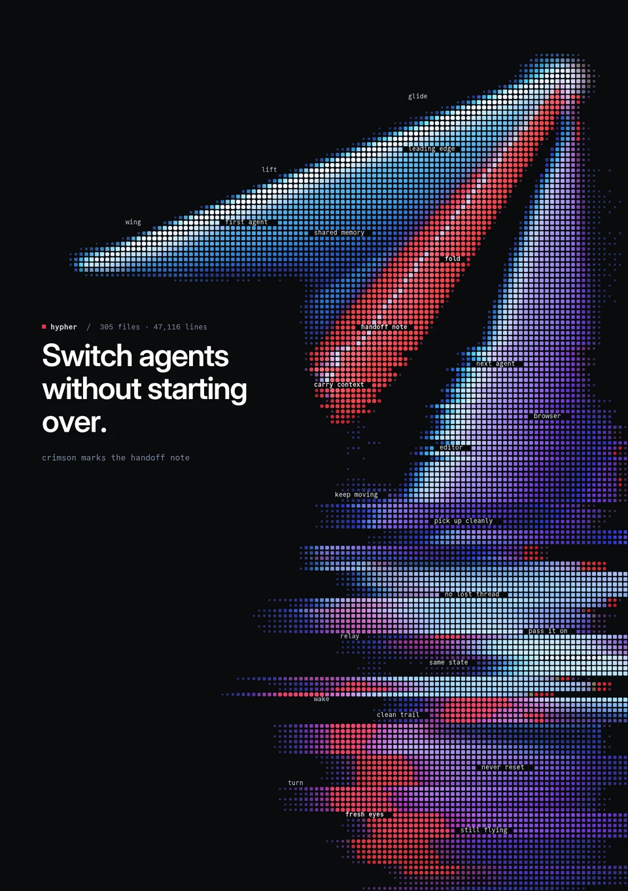

# vyo

<p align="center"></p>

**Your agent reads the repo, then draws it as a poster.**

vyo scans a codebase into real files, lines and cross-area imports. Your coding agent (Cursor, Claude Code or Codex) invents and draws a bespoke soft-lit visual explanation on the spot — **no pre-made shapes** — and vyo refracts it through your codebase's real strata across **5 optical print styles** and **5 curated palettes**:

- **Print styles (`--style`):** `obsidian` (7px dark luminous mosaic), `alabaster` (7px daylight museum screenprint), `optics` (continuous darkroom refraction with RGB fringe and 35mm grain), `riso` (3-plate multiply risograph on warm washi paper), and `contour` (24-level Marching Squares topographic iso-lines).
- **Curated palettes (`--palette`):** `crimson`, `pine`, `abyss` (dark grounds) and `vermilion`, `cobalt` (light grounds).
- **One drawing, five mediums:** Author one soft-lit SVG once; vyo auto-detects polarity and renders natively across all five styles.
- **Automated checks:** `luminous-tonal`, `luminous-accent`, `luminous-sanctuary` and `luminous-jargon` inspect every rendered sheet so flat clip-art, blown-out highlights, code jargon, file paths, placeholders, or artwork colliding with typography fail with exact fix instructions.

Legacy frames (`plate`, `cover`, `loose`, `signal`, `swiss`) and `vyo series` remain fully supported.

## Install

Run these three commands in the repository you want to explain:

```bash
npm install --save-dev @litterthanlit/vyo
npx vyo init
npx playwright install chromium
```

1. The first command adds the CLI and bundled fonts.
2. `npx vyo init` copies the skill into `.cursor/skills/vyo/` and `.claude/skills/vyo/`. When the repository already has one of those folders, it writes only that one. Pass `--cursor` or `--claude` to choose, `--codex` to also add a short block to `AGENTS.md` that points Codex at the skill, and `--dir <repo>` to install into another folder. Running it again overwrites the same files.
3. The last command downloads the Chromium that renders the poster. If you already have Chromium or Chrome, set `VYO_CHROMIUM` to its path instead.

To try vyo without adding it to the project, run `npx -y @litterthanlit/vyo init` and have your agent run `npx -y @litterthanlit/vyo` wherever the skill says `npx vyo`.

## Make a poster

Say this to your agent:

> "Analyze this repo and explain what it does as a vyo poster."

Or pick a medium directly: *"Make a riso or contour poster for this codebase."*

The agent follows the skill, runs `vyo scan`, `vyo compose --frame luminous`, `vyo sketch` and `vyo render`, and writes a 2× PNG, a thumbnail and a print-ready PDF into `vyo/` at the repository root.

To steer the story, copy `project-context.example.md` from the skill folder to `project-context.md` beside it and fill in the product's name, audience and focus.

## What it reads

- Nothing leaves your machine. `vyo scan` makes no network calls and calls no model.
- Your code is never executed. The scan reads source files as text and runs only `git`, to read the latest commit, with hooks switched off.
- Dotfiles such as `.env`, hidden folders, tests, `node_modules` and build output at a project root are skipped.

## Languages

JavaScript, TypeScript, Python and Agent Skills `.md` repositories get full structural detection (screens, requests, saved records and skill layouts). Go, Ruby, Rust, PHP, Java, Kotlin, Swift, C#, C and C++, Dart, Scala, Elixir, Lua and Zig are scanned and drawn by size and imports.

## Requirements

Node.js 20 or later (Playwright needs it), and Chromium for `render`, `sketch` (luminous) and `check`.

## Licence

MIT. The bundled fonts — Commit Mono, Newsreader and Inter (subset) — are under the SIL Open Font License 1.1. See `fonts/LICENSE.md`.
