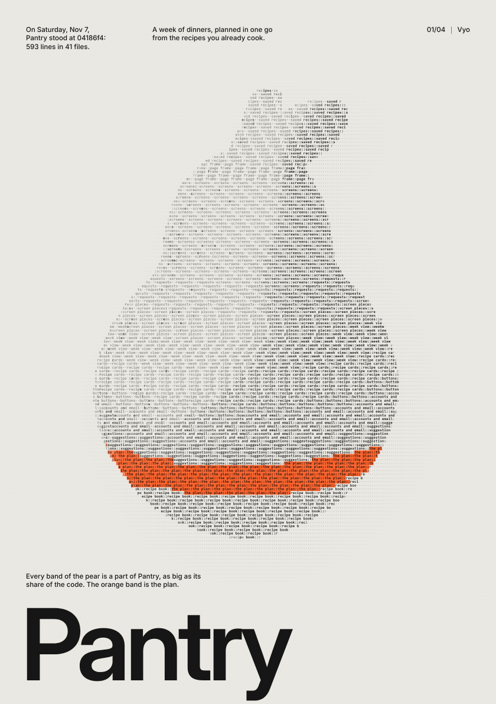
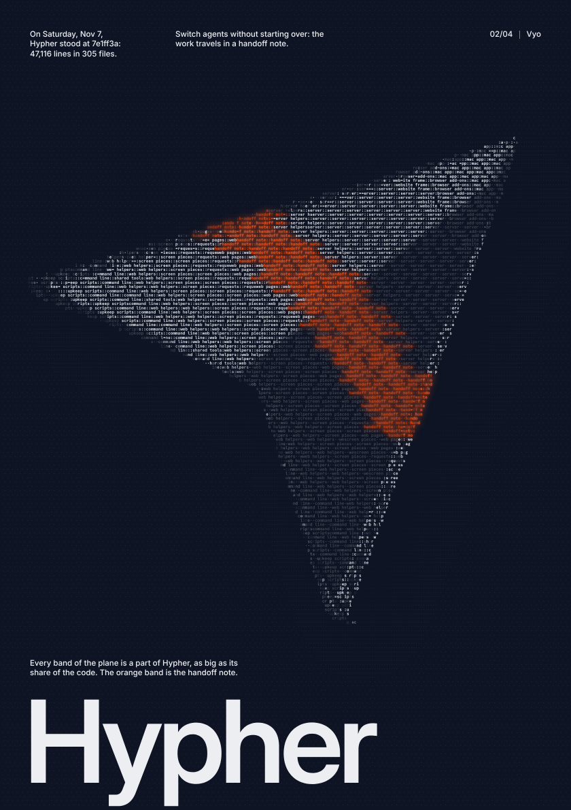
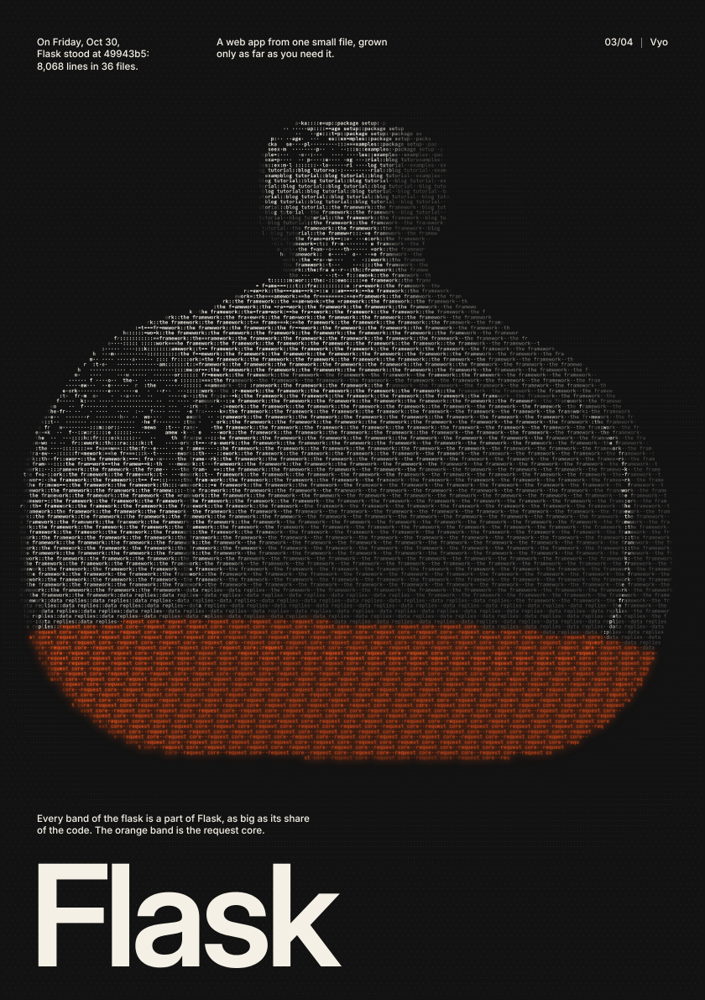
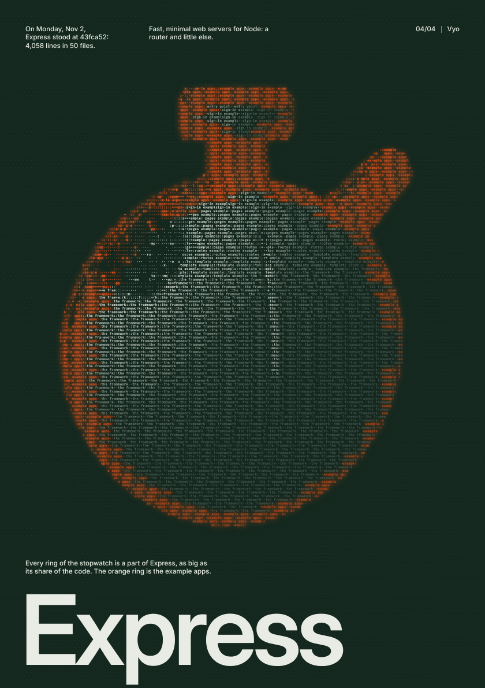
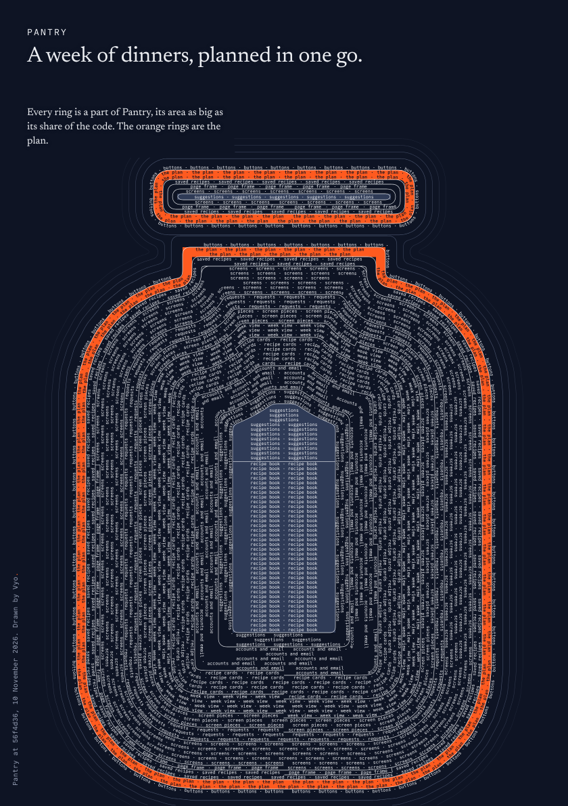
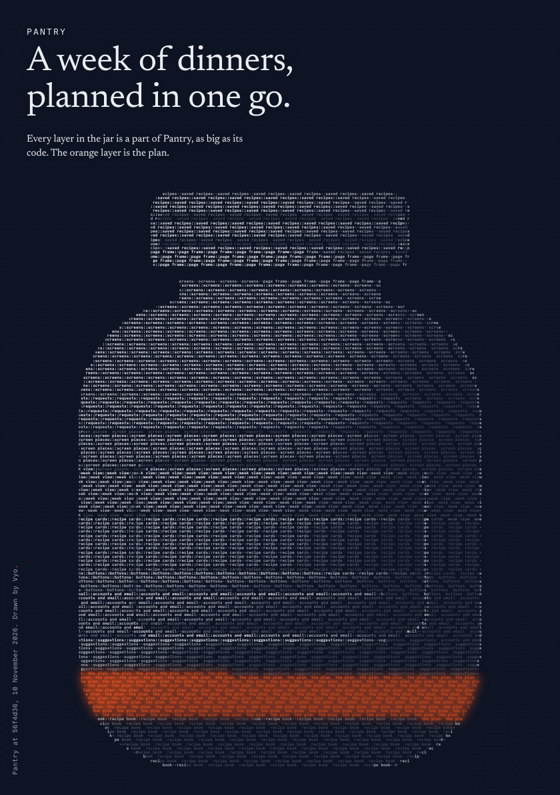
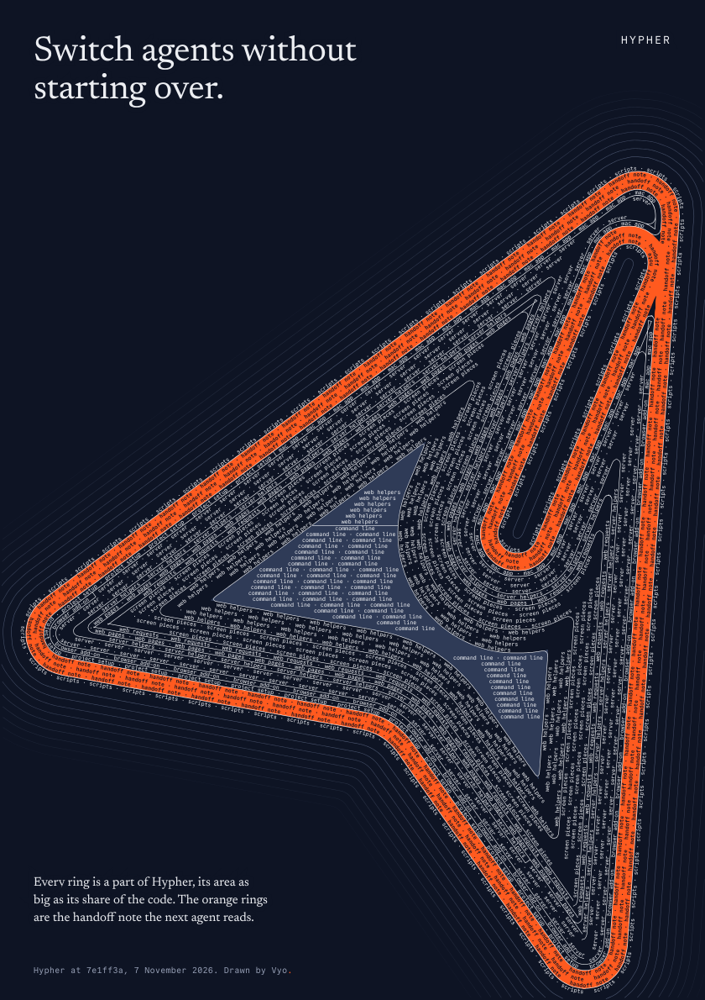
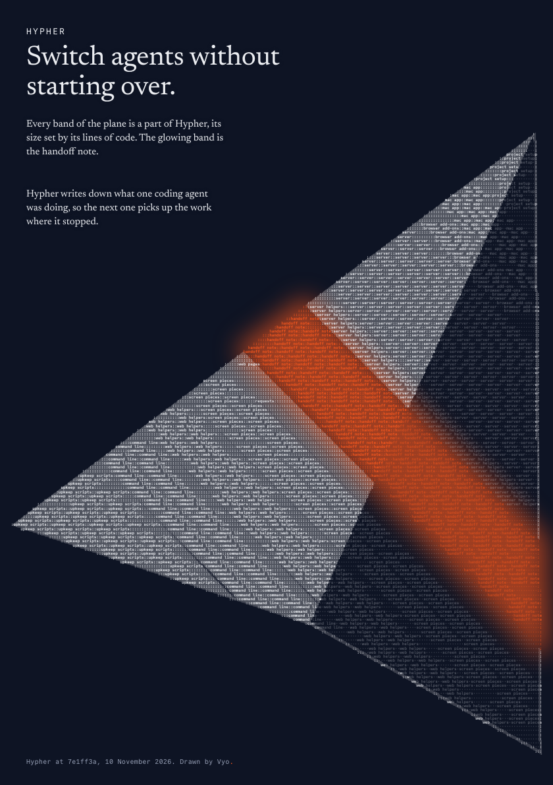

# vyo

vyo draws a codebase as one poster or cover that someone who does not code can read. Your coding agent draws an object for what the product does, and vyo sizes every part of the code to fit it.

<table align="center">
  <tr>
    <td align="center" valign="top"><a href="docs/posters/cover-pantry.gif"></a></td>
    <td align="center" valign="top"><a href="docs/posters/cover-hypher.gif"></a></td>
    <td align="center" valign="top"><a href="docs/posters/cover-flask.gif"></a></td>
    <td align="center" valign="top"><a href="docs/posters/cover-express.gif"></a></td>
  </tr>
</table>

<p align="center">Four covers on one template. Each object turns slowly under a fixed lamp: click a cover for its loop. Every band is a part of the code, as big as its share of the lines, and the orange one is the part the product is about. Flask and Express are the open-source projects; Pantry is a recipe planner kept as a test fixture; Hypher hands work from one coding agent to the next.</p>

The same engine draws posters in other looks:

<table align="center">
  <tr>
    <td align="center" valign="top"></td>
    <td align="center" valign="top"></td>
  </tr>
  <tr>
    <td align="center" valign="top"></td>
    <td align="center" valign="top"></td>
  </tr>
</table>

<p align="center">The same two products in two of the looks. Pantry is a recipe planner kept as a test fixture. Hypher is a tool for handing work from one coding agent to the next.</p>

## The looks

**Vector Data-as-Art Plates** (`--frame plate`) turn the codebase's real file slices, line counts, and cross-area import graph directly into pure high-resolution vector prints:

- **topo** — marching-squares topographic elevation map rising around each area's lines and import passes, with index/minor contours and summit markers (`pulse` loop).
- **blueprint** — octilinear PCB / architectural circuit schematic with proportional part chambers subdivided into file cells and wired by chamfered import traces and vias (`signal` loop).

**Sculptural 3D Covers** (`--frame cover`) turn an object your agent draws for the product (or a logo traced from a PNG) into a 3D object (`dome`, `extrude`, or `revolve` solids) cut honestly into layers by each part's share of the code, with four selectable high-res **finishes**:

- **studio** — continuous-tone studio-lit matte obsidian/metallic/ceramic 3D surface with softbox key, Fresnel rim, distance-field ambient occlusion, accent bloom, film grain, and subtle 5px micro-type shimmer.
- **halftone** — precision 22.5° rotated dot-matrix sampled from the studio lighting buffer with accent bloom.
- **wireframe** — smoked-glass Fresnel body with depth-tested 3D latitude, longitude, and elevation contour hairlines.
- **type** — sculpted 6px Commit Mono typographic relief across three visual looks: **living** (slowly turning volume under a fixed lamp), **xerox** (2-plate thresholded toner photocopy with paper grain, archive stamp & copier loop), and **spin** (full 360° kinetic turntable).

Both plates and covers share **4 gallery layouts** (`classic`, `editorial`, `blueprint`, `macro`), **3 formats** (`poster` 840×1190, `square` 960×960, `og` 1280×640), **5 refined studio & archival palettes** (`obsidian`, `carbon`, `abyss`, `graphite`, `bone`) — plus 9 legacy grounds (`navy`, `charcoal`, `forest`, `paper`, `cobalt`, `xerox`, `riso`, `blood`, `acid`) kept for backward compatibility — and `vyo series` to compose 2–4 covers or plates into one gallery contact sheet or synchronized GIF.

A **shape** poster draws a silhouette in one of three styles — **relief** (lit sculpted volume, default), **rings** (concentric outline rings), or **symbols** (shaded `- : = + #` ASCII art) — in either the serif `loose` frame or the brutalist high-contrast `signal` frame. When no single object fits, vyo also generates typographic fields directly from the scan: **seismic**, **orbit**, **river**, **terrain**, **slabs**, **spiral**, **contour**, and more. `vyo render --gif` animates any spec with `motion`.

## Install and make a poster

Run these in the project you want to explain:

```bash
npm install --save-dev @litterthanlit/vyo
npx vyo init
npx playwright install chromium
```

`npx vyo init` copies the skill into `.cursor/skills/vyo/` and `.claude/skills/vyo/`. If you already have a Chromium or Chrome, set `VYO_CHROMIUM` to its path and skip the last command. Node.js 20 or later is required.

Then say this to your agent:

> Explain this app as a poster. Draw it as a shape.

or, for a cover with its loop:

> Make a cover for this app.

The agent follows the skill and replies with the paths of a PNG and a PDF, and for a cover a GIF, in `vyo/` at the project root.

To try vyo without installing it, run `npx -y @litterthanlit/vyo init` and have the agent run `npx -y @litterthanlit/vyo` wherever the skill says `npx vyo`.

## How it works

1. `vyo scan` reads the code with no network and no model. Two scans of the same tree give the same file.
2. Your agent names each part in plain words and chooses the part the product is about. For a shape, it reads the README, picks an object for what the product does, and draws it from a few simple pieces.
3. `vyo sketch` shows the layout in a quick picture before the full render. The agent writes the one word the sketch reads as, and redraws until that word is the object.
4. `vyo render` draws the poster to HTML, PNG and PDF.
5. Checks run on what was drawn. They reject jargon, file paths, placeholder text and text that collides with the picture, and each failure says what to change.

## What it reads

- Nothing leaves your machine. The scan makes no network calls and calls no model.
- Your code is never executed. The scan reads source files as text. The only program it runs is `git`, to read the latest commit, with hooks switched off.
- Dotfiles such as `.env`, hidden folders, tests, `node_modules`, and build output at a project root are skipped.

## Languages

JavaScript, TypeScript and Python get full detection: screens, requests and saved records. Go, Ruby, Rust, PHP, Java, Kotlin, Swift, C#, C and C++, Dart, Scala, Elixir, Lua and Zig are drawn by size.

## More

- [The skill folder](.cursor/skills/vyo/) holds `SKILL.md`, the plain-language rules and the examples.
- [tools/README.md](.cursor/skills/vyo/tools/README.md) lists every command, the spec, and every check.
- [Package README](.cursor/skills/vyo/README.md) is the page shown on npm.

## Licence

MIT. See [LICENSE](LICENSE). The bundled fonts, Commit Mono, Newsreader and Inter, are under the SIL Open Font License 1.1. See [fonts/LICENSE.md](.cursor/skills/vyo/fonts/LICENSE.md).
