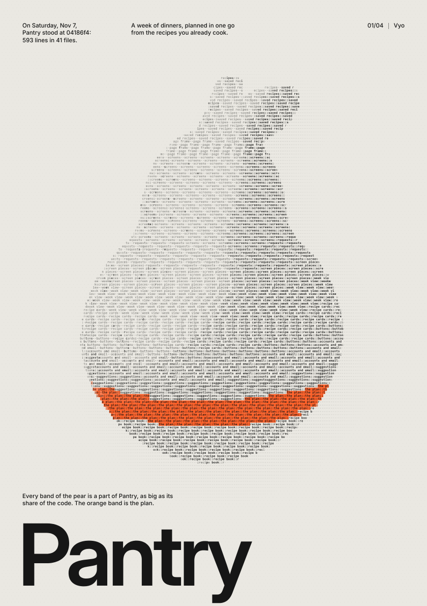
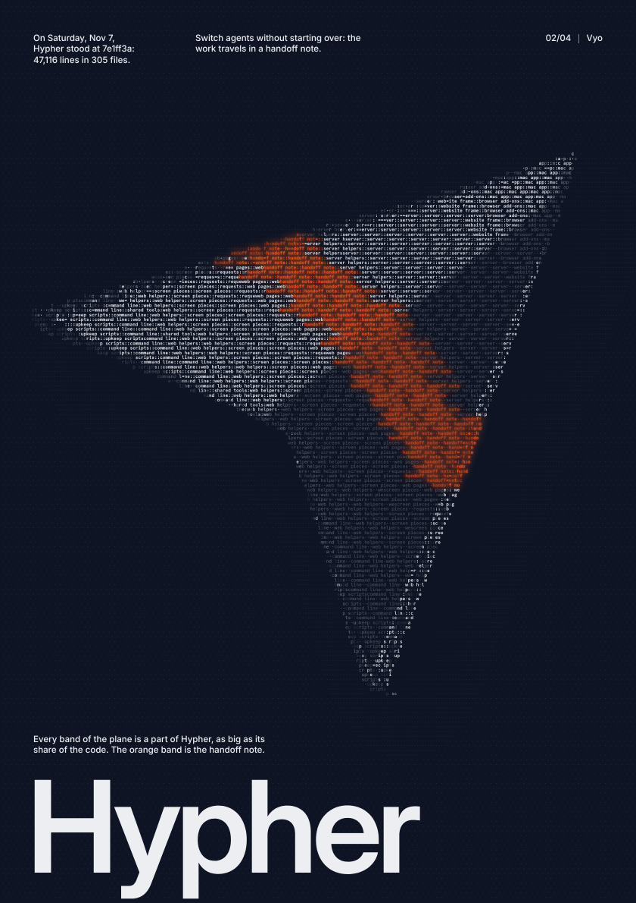
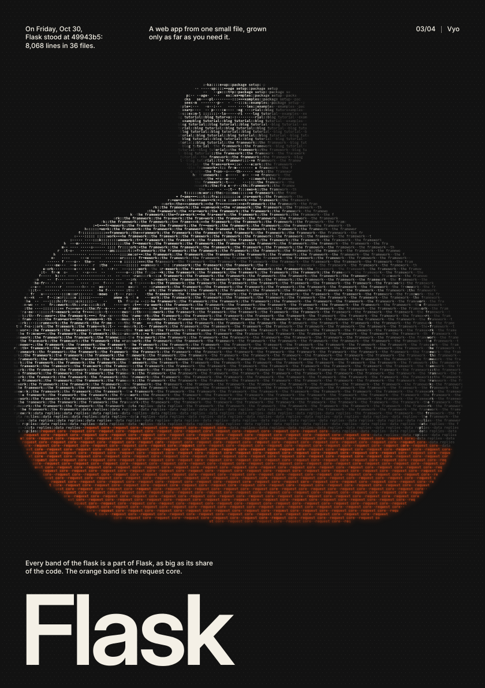
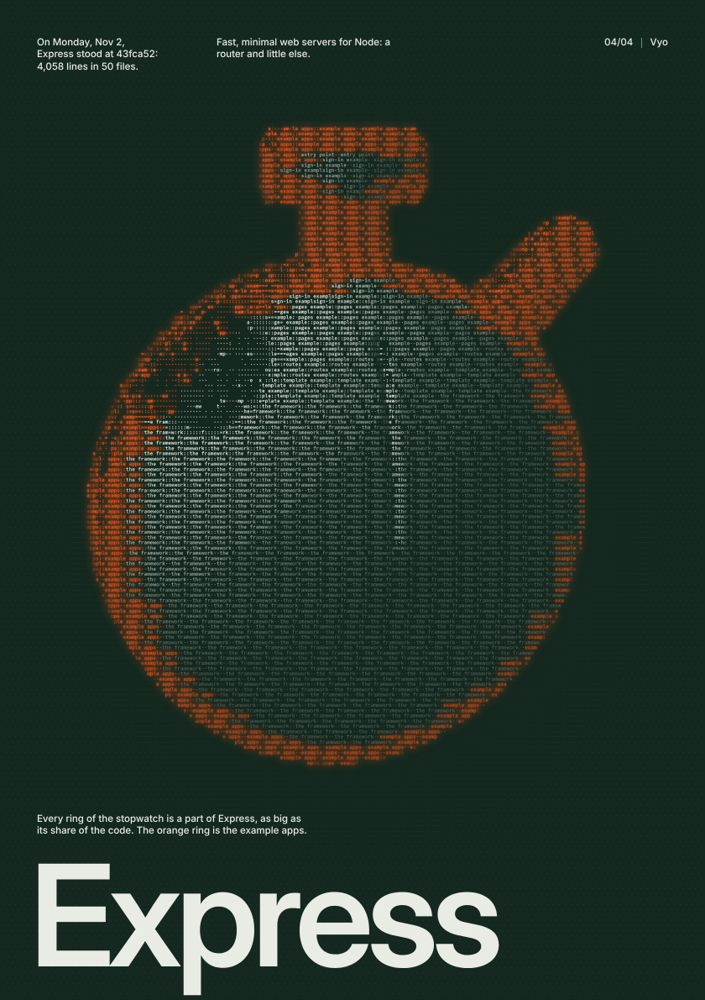

# vyo

vyo draws a codebase as one poster or cover that someone who does not code can read. Your coding agent picks an object for the product, and vyo sizes every part of the code to fit it.

<table align="center">
  <tr>
    <td align="center" valign="top"><a href="docs/posters/cover-pantry.gif"></a></td>
    <td align="center" valign="top"><a href="docs/posters/cover-hypher.gif"></a></td>
    <td align="center" valign="top"><a href="docs/posters/cover-flask.gif"></a></td>
    <td align="center" valign="top"><a href="docs/posters/cover-express.gif"></a></td>
  </tr>
</table>

<p align="center">Four covers on one template. Each object turns slowly under a fixed lamp: click a cover for its loop. Every band is a part of the code, as big as its share of the lines, and the orange one is the part the product is about. Flask and Express are the open-source projects; Pantry is a recipe planner kept as a test fixture; Hypher hands work from one coding agent to the next.</p>

The same engine draws posters in other looks:

<table align="center">
  <tr>
    <td align="center" valign="top"></td>
    <td align="center" valign="top"></td>
  </tr>
  <tr>
    <td align="center" valign="top"></td>
    <td align="center" valign="top"></td>
  </tr>
</table>

<p align="center">The same two products in two of the looks. Pantry is a recipe planner kept as a test fixture. Hypher is a tool for handing work from one coding agent to the next.</p>

## The looks

A shape poster has one `style`. You pick it, or your agent does. The shape is drawn from a few ops, or traced from a PNG.

- **relief**, the default, draws the outline as a lit, sculpted volume in dense small type. The object itself is the pull.
- **rings** sets the names along the outline, ring inside ring. It suits a fat, round object.
- **symbols** draws the outline in shaded clusters of `- : = + #`, like ASCII art.

The **cover** frame, at the top of this page, takes one of twelve ready objects (or one you draw), turns it in a seven-second loop, and puts the part the product is about on its outer shell in orange, on a navy, forest, charcoal or paper ground.

Any of them sits in the default frame shown here or in the high-contrast `signal` frame: a charcoal or paper ground, one signal colour, a grotesque headline, metadata and highlighter marks. vyo also generates fields when no one object fits the product, such as a wave, a terrain, a river, a coil or one giant letter, and `vyo render --gif` animates a poster.

## Install and make a poster

Run these in the project you want to explain:

```bash
npm install --save-dev @litterthanlit/vyo
npx vyo init
npx playwright install chromium
```

`npx vyo init` copies the skill into `.cursor/skills/vyo/` and `.claude/skills/vyo/`. If you already have a Chromium or Chrome, set `VYO_CHROMIUM` to its path and skip the last command. Node.js 20 or later is required.

Then say this to your agent:

> Explain this app as a poster. Draw it as a shape.

or, for a cover with its loop:

> Make a cover for this app.

The agent follows the skill and replies with the paths of a PNG and a PDF, and for a cover a GIF, in `vyo/` at the project root.

To try vyo without installing it, run `npx -y @litterthanlit/vyo init` and have the agent run `npx -y @litterthanlit/vyo` wherever the skill says `npx vyo`.

## How it works

1. `vyo scan` reads the code with no network and no model. Two scans of the same tree give the same file.
2. Your agent names each part in plain words and chooses the part the product is about. For a shape, it draws the silhouette from a few simple pieces.
3. `vyo sketch` shows the layout in a quick picture before the full render, so the agent can fix the shape first.
4. `vyo render` draws the poster to HTML, PNG and PDF.
5. Checks run on what was drawn. They reject jargon, file paths, placeholder text and text that collides with the picture, and each failure says what to change.

## What it reads

- Nothing leaves your machine. The scan makes no network calls and calls no model.
- Your code is never executed. The scan reads source files as text. The only program it runs is `git`, to read the latest commit, with hooks switched off.
- Dotfiles such as `.env`, hidden folders, tests, `node_modules`, and build output at a project root are skipped.

## Languages

JavaScript, TypeScript and Python get full detection: screens, requests and saved records. Go, Ruby, Rust, PHP, Java, Kotlin, Swift, C#, C and C++, Dart, Scala, Elixir, Lua and Zig are drawn by size.

## More

- [The skill folder](.cursor/skills/vyo/) holds `SKILL.md`, the plain-language rules and the examples.
- [tools/README.md](.cursor/skills/vyo/tools/README.md) lists every command, the spec, and every check.
- [Package README](.cursor/skills/vyo/README.md) is the page shown on npm.

## Licence

MIT. See [LICENSE](LICENSE). The bundled fonts, Commit Mono, Newsreader and Inter, are under the SIL Open Font License 1.1. See [fonts/LICENSE.md](.cursor/skills/vyo/fonts/LICENSE.md).
