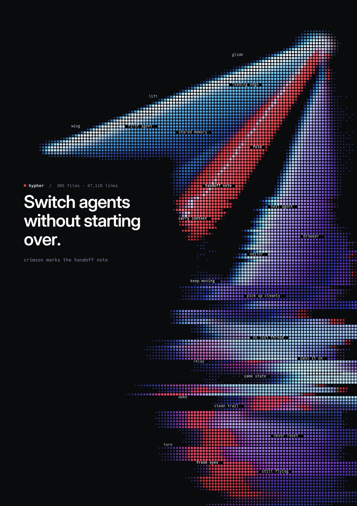
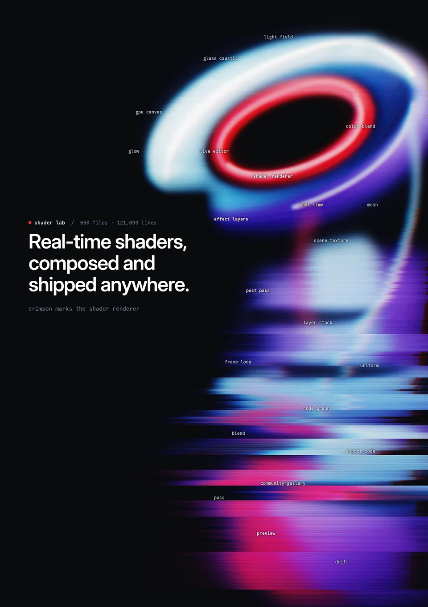
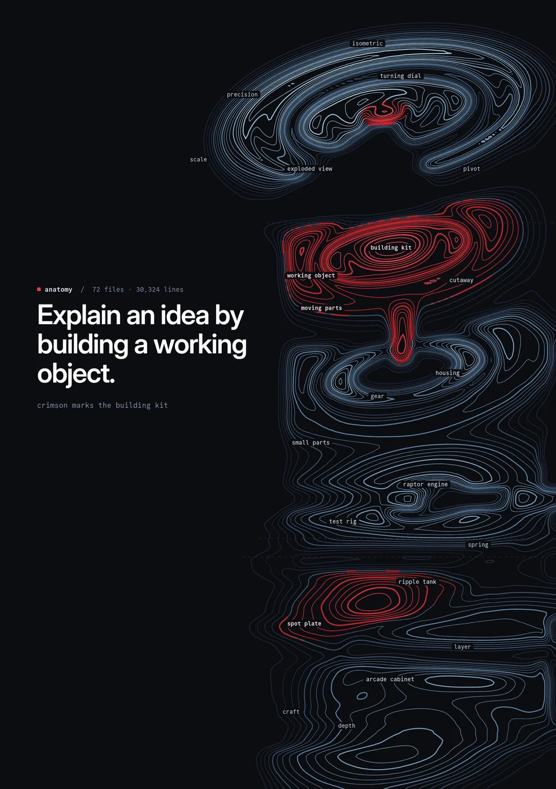
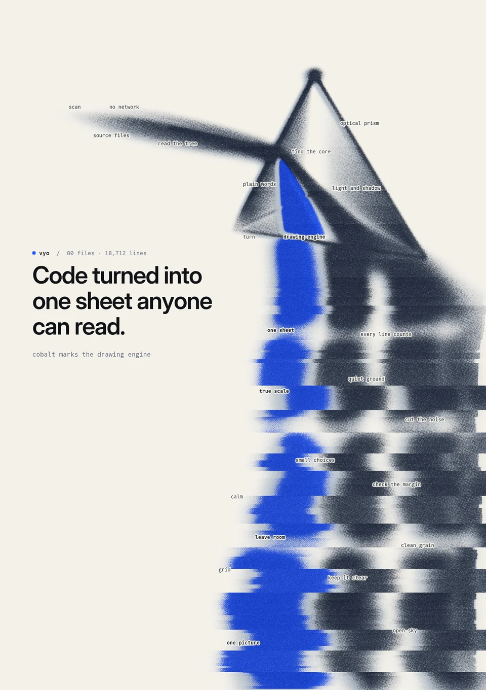
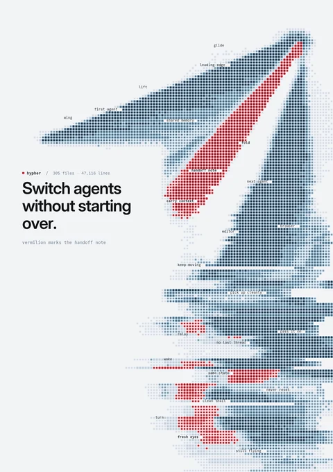
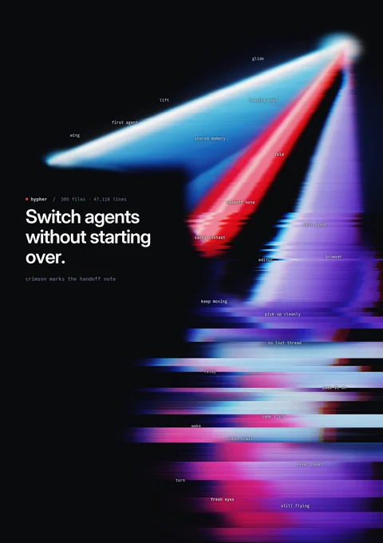
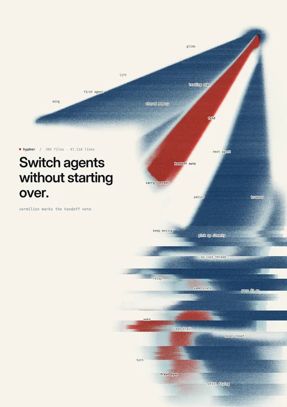
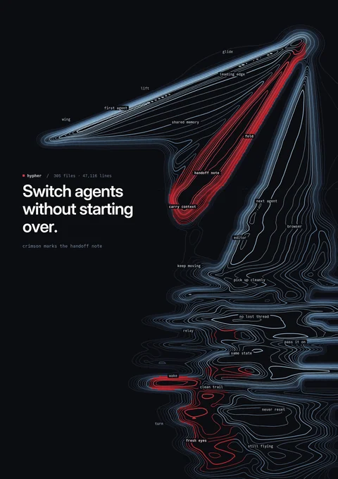

# vyo

**Your agent reads the repo, then draws it as a poster.**

vyo scans a codebase into its real files, lines and imports. Your coding agent invents and draws a bespoke soft-lit visual explanation on the spot — **zero pre-made shapes** — and vyo prints it through five optical print styles and automated quality checks.

<table align="center">
  <tr>
    <td align="center" valign="top">
      <br>
      <sub><strong>Hypher</strong> &middot; <code>obsidian &middot; crimson</code></sub>
    </td>
    <td align="center" valign="top">
      <br>
      <sub><strong>Shader Lab</strong> &middot; <code>optics &middot; crimson</code></sub>
    </td>
    <td align="center" valign="top">
      <br>
      <sub><strong>Anatomy</strong> &middot; <code>contour &middot; crimson</code></sub>
    </td>
    <td align="center" valign="top">
      <br>
      <sub><strong>vyo</strong> &middot; <code>riso &middot; cobalt</code></sub>
    </td>
  </tr>
</table>

<p align="center">Four real repositories, four bespoke agent-drawn visual explanations. Strata band heights equal each area's real share of source lines, horizontal refraction shear and chromatic fringe come from real cross-file imports, and the focal accent highlights the part the product is about.</p>

### One agent drawing → 5 print styles

Switch mediums without redrawing a single path. Every print below is rendered from the exact same 7.1 KB soft-lit Hypher SVG and real codebase scan (305 files · 47,116 lines · 531 imports):

<table align="center">
  <tr>
    <td align="center" valign="top">
      <br>
      <sub><code>obsidian</code></sub>
    </td>
    <td align="center" valign="top">
      <br>
      <sub><code>alabaster</code></sub>
    </td>
    <td align="center" valign="top">
      <br>
      <sub><code>optics</code></sub>
    </td>
    <td align="center" valign="top">
      <br>
      <sub><code>riso</code></sub>
    </td>
    <td align="center" valign="top">
      <br>
      <sub><code>contour</code></sub>
    </td>
  </tr>
</table>

## The styles

**Luminous Prints (`--frame luminous`, v0.3.0 flagship)** pair one agent-authored soft-lit SVG metaphor with codebase-driven refraction, frameless typography, and zone-anchored plain-language micro-type across **5 optical print styles**:

- **`obsidian`** *(default)* — deep pitch-black `7px` luminous optical mosaic (`120×170`) with HDR codebase strata refraction and glowing focal beads.
- **`alabaster`** — crisp daylight `7px` museum screenprint with automatic light/dark tonal translation on archival paper.
- **`optics`** — full-resolution continuous darkroom refraction with horizontal slice cuts, kinetic trails, cyan-paired chromatic dispersion, specular halation, and fine 35mm film grain.
- **`riso`** — 3-plate tactile risograph on warm archival washi paper (`#F6F3EB`) with codebase-driven plate misregistration, optical `multiply` overprint, and cotton-fiber ink grain.
- **`contour`** — 24-level Marching Squares topographic elevation iso-lines with glowing accent contours, codebase fault-line ticks, and cartographic label breaks.

All five styles pair with **5 curated palettes (`--palette`)**: `crimson`, `pine`, and `abyss` on dark grounds; `vermilion` and `cobalt` on light grounds. Author one SVG once — the engine auto-detects polarity and translates it across all five mediums without redrawing.

**Legacy frames remain supported:** Data-as-Art Vector Plates (`--frame plate`: `topo`, `blueprint`), Sculptural 3D Covers (`--frame cover`: `studio`, `halftone`, `wireframe`, `type`, plus `xerox`/`spin` looks and `vyo render --gif`), Editorial Shape & Field Posters (`--frame loose`, `--frame signal`, `--frame swiss`), and multi-poster contact sheets (`vyo series`).

## Install and make a poster

Run these in the project you want to explain:

```bash
npm install --save-dev @litterthanlit/vyo
npx vyo init
npx playwright install chromium
```

`npx vyo init` copies the skill into `.cursor/skills/vyo/` and `.claude/skills/vyo/` (pass `--cursor`, `--claude`, or `--codex` to choose). If you already have Chromium or Chrome, set `VYO_CHROMIUM` to its path and skip the last command. Node.js 20 or later is required.

Then say this to your agent:

> "Analyze this repo and explain what it does as a vyo poster."

Or ask for a specific print style:

> "Make a riso or contour poster for this codebase."

The agent follows the skill and writes a 2× PNG (`1680×2380`), a thumbnail, and a print-ready PDF into `vyo/` at the project root.

To try vyo without installing it, run `npx -y @litterthanlit/vyo init` and have the agent run `npx -y @litterthanlit/vyo` wherever the skill says `npx vyo`.

## How it works

1. **`vyo scan`** reads the codebase as text into `facts.json` (files, lines, and cross-area imports) with no network and no model. Two scans of the same tree give the exact same file.
2. **`vyo compose`** scaffolds a `--frame luminous` spec for your chosen `--style` and `--palette`. Your coding agent reads the repo, invents and draws a bespoke soft-lit SVG metaphor explaining the product, names each part in plain words, and places zone-anchored micro-type.
3. **`vyo sketch`** renders a fast preview of the artwork, strata refraction, and typography sanctuary so the agent can inspect and refine before the full optical pass.
4. **`vyo render`** prints the final HTML, 2× PNG, thumbnail, and print-ready PDF in headless Chromium.
5. **Automated checks** measure the finished sheet: `luminous-tonal` flags flat clip-art SVGs, `luminous-accent` verifies focal balance, `luminous-sanctuary` fails if bright artwork collides with typography, and `luminous-jargon` rejects code jargon, file paths, and leftover placeholders. Any `✗` finding exits 1 and names the exact change to make.

## What it reads

- Nothing leaves your machine. The scan makes no network calls and calls no model.
- Your code is never executed. The scan reads source files as text. The only program it runs is `git`, to read the latest commit, with hooks switched off.
- Dotfiles such as `.env`, hidden folders, tests, `node_modules`, and build output at a project root are skipped.

## Languages

JavaScript, TypeScript, Python and Agent Skills `.md` repositories get full structural detection (screens, requests, saved records, and skill layouts). Go, Ruby, Rust, PHP, Java, Kotlin, Swift, C#, C and C++, Dart, Scala, Elixir, Lua and Zig are scanned and drawn by size and imports.

## More

- [The skill folder](.cursor/skills/vyo/) holds `SKILL.md`, the plain-language rules and the examples.
- [tools/README.md](.cursor/skills/vyo/tools/README.md) lists every command, the spec, and every check.
- [Package README](.cursor/skills/vyo/README.md) is the page shown on npm.

## Licence

MIT. See [LICENSE](LICENSE). The bundled fonts, Commit Mono, Newsreader and Inter, are under the SIL Open Font License 1.1. See [fonts/LICENSE.md](.cursor/skills/vyo/fonts/LICENSE.md).
