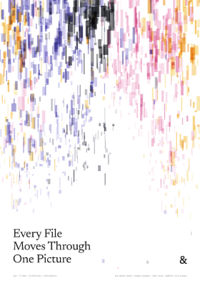
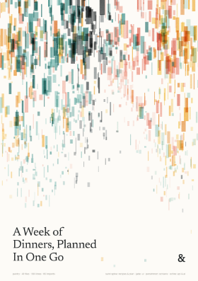

# Exploration B — `b-cascade` (Editorial Translucent Cascade)

Gallery-grade codebase posters inspired by Swiss/Japanese archival print craft: a dense tapestry of strictly rectilinear, translucent vertical bars pouring down from the top edge (`y = 0`) and bleeding off the left and right margins, composited with true `multiply` translucency and tactile risograph pigment grain, tapering organically into scattered droplets above a serene gallery-white lower third.

## Outputs

| Codebase | Full Poster (1680×2380) | Preview (280px) |
| --- | --- | --- |
| **`vyo`** (71 files · 12,559 LOC · 228 imports) | [`out/vyo-cascade.png`](out/vyo-cascade.png) |  |
| **`pantry`** (41 files · 593 LOC · 60 imports) | [`out/pantry-cascade.png`](out/pantry-cascade.png) |  |

## Data-to-Form Grammar

Every bar is deterministically derived from real scanned codebase facts (`layout.mjs`):

- **Proportional Subdivision**: Every real source file maps to a vertical rain stream of shards, proportional to `LOC^p` with a slight centrality boost (`1.45 × inDeg + 0.75 × outDeg`), producing ~1,150–1,200 layered shards per poster so even small leaf files appear while large hubs bloom into multi-column cascades.
- **Horizontal Architectural Zones**:
  - **`vyo`** (gallery white `#FFFFFF` + charcoal / indigo / orchid-rose / marigold-saffron):
    - **Central Ink Spine (`tools/lib/fields/*`)**: 19 files, 2,882 LOC — deep charcoal anchors concentrated at upper-center, tapering into slender graphite needles.
    - **Left-of-Center Indigo (`tools/lib/*` engine)**: 21 core geometry/spec/render/check files — rich periwinkle & violet-indigo.
    - **Right-of-Center Rose (`tools/lib/scan/*`)**: 22 scanner & detector files — luminous dusty rose & blush pink.
    - **Warm Saffron Flanks**: CLI & examples (`tools/vyo.mjs`, `examples/posters/*`) on far left; cover/poster surfaces (`tools/lib/cover*`) on far right.
  - **`pantry`** (warm archival washi `#FDFBF7` + sumi / mineral verdigris / Kyoto persimmon / gingko ochre & celadon):
    - **Central Sumi Spine (`lib/recipes/*`, `lib/plan/*`, `prisma/schema.prisma`)**: 7 files, 141 LOC — recipe/meal-plan domain and schema.
    - **Left-of-Center Verdigris Jade (`components/*`)**: 14 UI & screen-piece files, 191 LOC.
    - **Right-of-Center Persimmon (`app/(app)/*`, `app/layout.tsx`)**: 8 user-facing screens, 123 LOC.
    - **Warm Ochre & Celadon Flanks**: API routes & weekly cron (`app/api/*`) on far left; AI & services (`lib/ai/*`, `lib/*`) on far right.
- **Dependency-Driven Color Weaving**: Real cross-zone `imports` pull a fraction of each file's shards horizontally toward its imported neighbors' columns (while keeping the source zone's pigment), creating organic cross-zone color threads rather than rigid stripes.
- **Cascade Depth & Multi-Scale Proportions**: Real import centrality and file LOC extend each file's vertical reach along an arching curtain envelope (fuller left/right curtains framing a luminous center-right clearing). Shards span four crisp 90° classes: top-heavy anchor slabs, compact mosaic ribbons, razor-thin hairline needles (`1.8–3.2px`), and falling trailing droplets, plus 4 whisper-faint hub echo droplets resting cleanly in the lower whitespace.
- **Multiply Translucency & Ink-Only Risograph Grain**: All bars composite onto the paper ground with `globalCompositeOperation = 'multiply'`, then a 2-octave stipple/cotton-fiber grain pass runs strictly over inked pixels (`inkDiff >= 3`), keeping the white negative space 100% pure and luminous.
- **Editorial Typography**: 3-line `Newsreader` 50px title bottom-left, bolded calligraphic `&` mark baseline-aligned bottom-right, and an ultra-quiet `9.2px` `Inter` hairline colophon along the bottom margin naming the real repo counts and zone color key.

## Iteration & Tuning Notes

1. **v1 → v2**: Fixed a multi-poster Playwright lexical scope reuse issue (`const DATA` on reused `about:blank` page) by giving each poster a fresh browser context + IIFE script wrapper. Increased shard count from ~650 long vertical strips to ~1,100 tighter mosaic blocks/needles, boosted chromatic saturation in indigo/rose/saffron, and moved stray droplets clear of the hairline colophon.
2. **v2 → v3**: Rebalanced the vertical density curve so the left and right color curtains stay vibrant through `y = 0.22–0.56` rather than over-bunching in the top 22%, narrowed the central spine (`0.355–0.555`) with lower top-slab density so gleaming white paper slits separate overlapping charcoal bars, and restricted outward spine echoes to slender ribbons/needles so dark ink never forms heavy blobs in the outer warm flanks.

## Render

```bash
node explorations/2026-11-23-editorial-grammars/b-cascade/render.mjs
```
